<div align="center">

<h1>我们这顿 · Lover Order</h1>

<p><strong>把「今天吃什么」，变成一张一起摆的实况自由画布。</strong></p>

<p>
  
  
  
  
</p>

<p>
  <a href="#界面预览">界面预览</a> ·
  <a href="#项目结构">项目结构</a> ·
  <a href="#本地快速启动">本地快速启动</a>
</p>

<br />

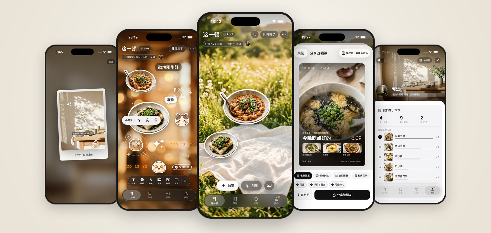

</div>

---

## 这是一个怎样的 App？

**「我们这顿」**围绕**对应「今天这一顿」的实况自由画布**展开——不是冷冰冰的点单列表，而是一块可以自由摆放菜品、写便签、贴手绘贴纸、涂鸦与定格吃饭回忆的餐桌桌面。

核心主线：

> **打开当前画布「这一顿」 → 从菜谱挑菜 & 自由画布创作 → 商量定下今天吃什么 → 吃完收进记录 → 生成海报分享这一顿**

- **日常协作场景**：面向伴侣或同居家庭一起决定每顿吃什么（不限制为只能两人）；家里来朋友时，也可通过点菜房间临时加入一起挑菜。
- **辅助工具闭环**：内置双向同步菜谱库、做菜买菜清单、带日期筛选与实况回放的用餐记录、家庭常吃「小本本」，以及 DIY 开屏动画和饭点消息提醒。

---

## 界面预览

### 1. 实况自由画布与手账创作

全屏无边框实景桌面（暖阳野餐、暖光咖啡等预设与相册照片），搭配 Apple Vision 主体抠图白边模切菜贴纸、错相飘浮微动效与 6 项手账创作工具。

<table align="center">
  <tr>
    <td align="center" width="33%">
      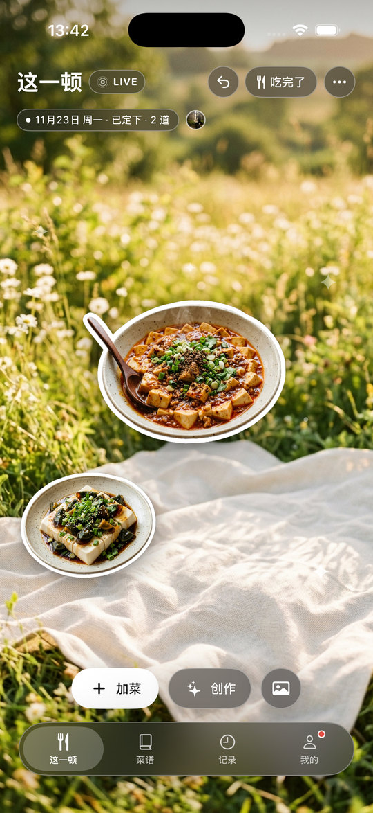<br />
      <b>实景自由画布「这一顿」</b><br />
      <sub>全屏实景底图、自动白边抠图菜贴纸与 <code>LIVE</code> 漂浮微动效</sub>
    </td>
    <td align="center" width="33%">
      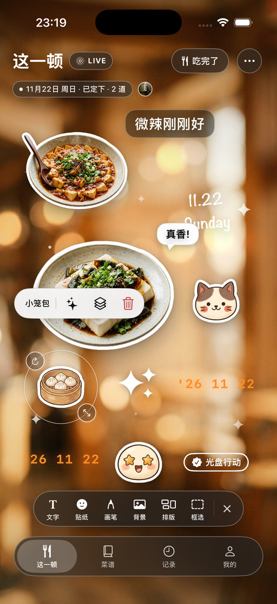<br />
      <b>6 项创作工具坞</b><br />
      <sub>手写文字、贴纸、霓虹画笔、5 档滤镜、4 套排版、框选与 20 步撤销</sub>
    </td>
    <td align="center" width="33%">
      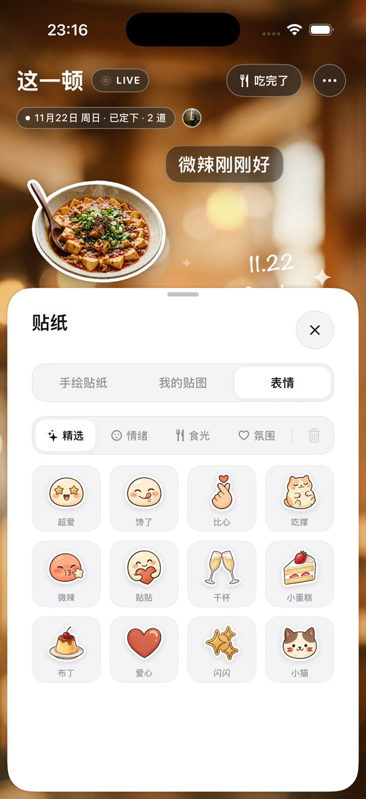<br />
      <b>水粉贴纸 &amp; 拍照抠图</b><br />
      <sub>36 枚水粉模切贴纸 + 16 枚 Plog 贴纸 + 相册/拍照主体抠图</sub>
    </td>
  </tr>
</table>

### 2. 饭后分享海报工坊（4 套 `@3x` 排版模板）

吃完一顿后可从首页更多菜单、餐后评价「保存并分享」或历史详情一键打开海报工坊，切换 4 套模板、轮换主图、控显栏目并导出 `@3x` 高清图或真 Live Photo。

<table align="center">
  <tr>
    <td align="center" width="25%">
      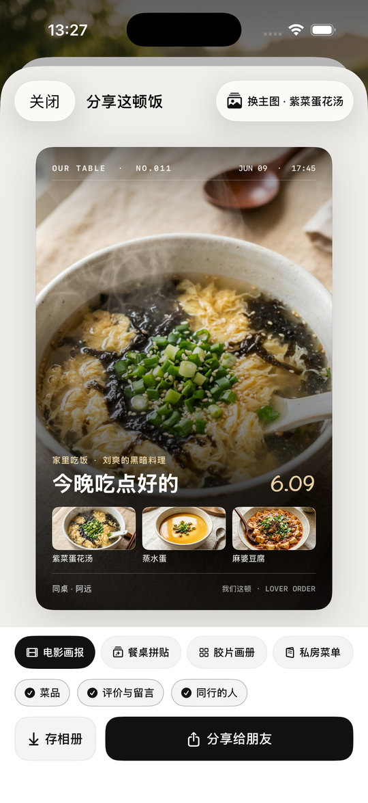<br />
      <b>电影画报</b><br />
      <sub>全幅实拍封面 + 三格胶片菜品条</sub>
    </td>
    <td align="center" width="25%">
      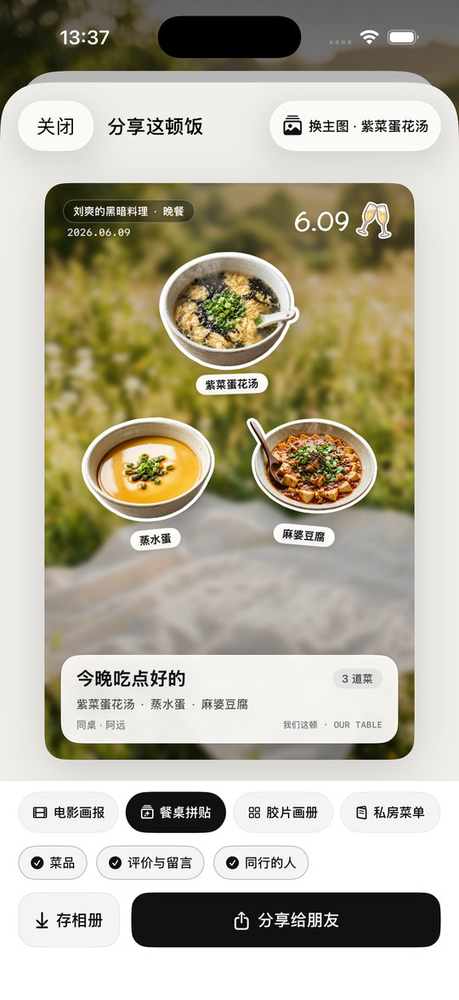<br />
      <b>餐桌拼贴</b><br />
      <sub>实景餐桌 + 白边模切菜贴纸摆盘</sub>
    </td>
    <td align="center" width="25%">
      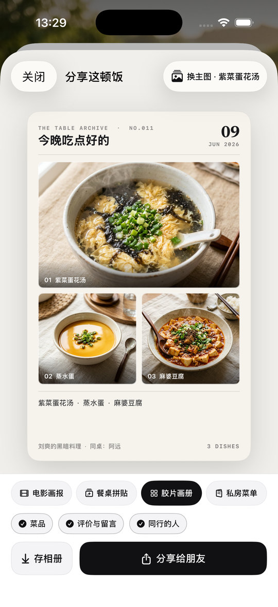<br />
      <b>胶片画册</b><br />
      <sub>棉纸画册感多图 Bento 拼排</sub>
    </td>
    <td align="center" width="25%">
      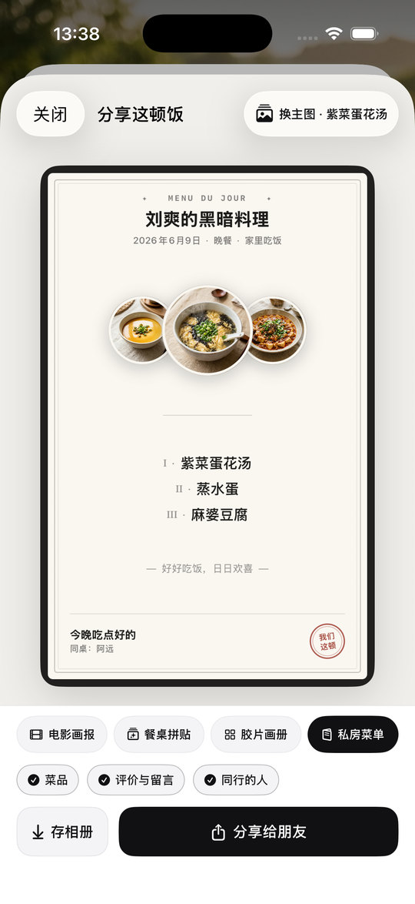<br />
      <b>私房菜单</b><br />
      <sub>胡桃木双线品鉴单 + 厨房红印</sub>
    </td>
  </tr>
</table>

### 3. 菜谱图库与实况用餐记录

菜谱卡片右上 `+` / `✓` 与当前画布双向实时同步；吃完进入记录流后，可在详情页按原始画布动态回放当时的排版、滤镜与笔迹。

<table align="center">
  <tr>
    <td align="center" width="25%">
      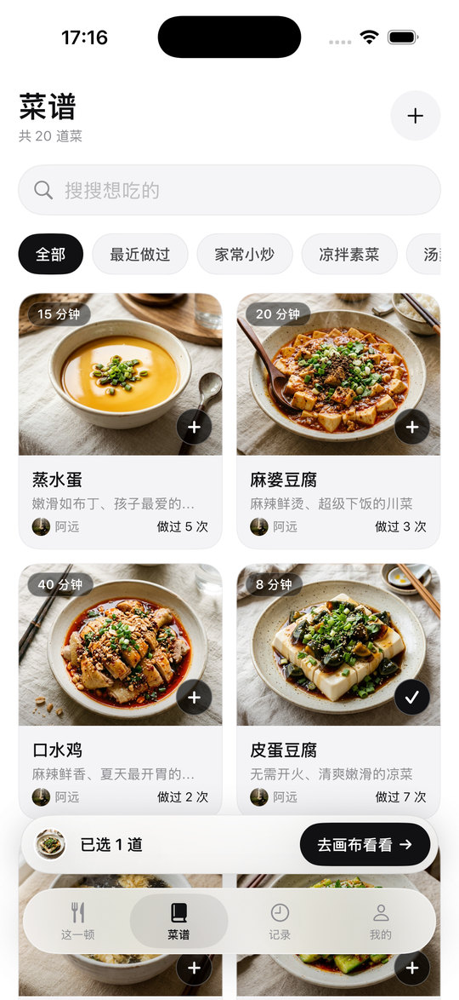<br />
      <b>菜谱库双向同步</b><br />
      <sub>卡片点选加菜与画布桌面实时联动</sub>
    </td>
    <td align="center" width="25%">
      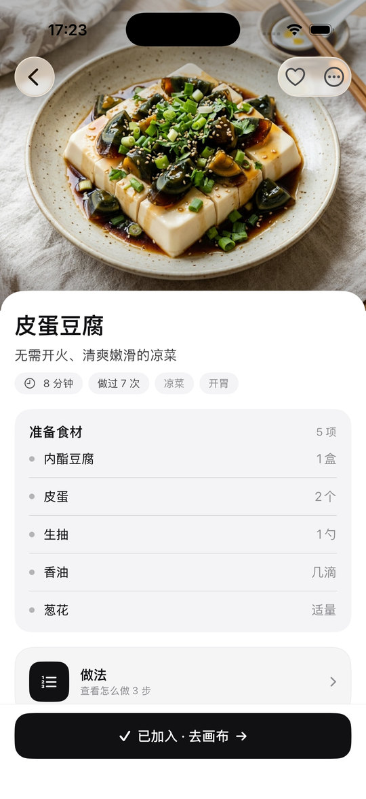<br />
      <b>全幅菜谱详情</b><br />
      <sub>340 pt 画廊封面、食材与分步做法</sub>
    </td>
    <td align="center" width="25%">
      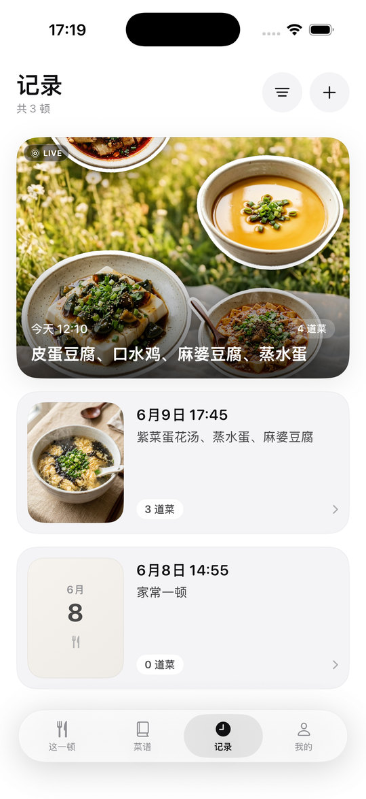<br />
      <b>用餐记录流</b><br />
      <sub>264 pt 海报首卡、场景筛选与补录</sub>
    </td>
    <td align="center" width="25%">
      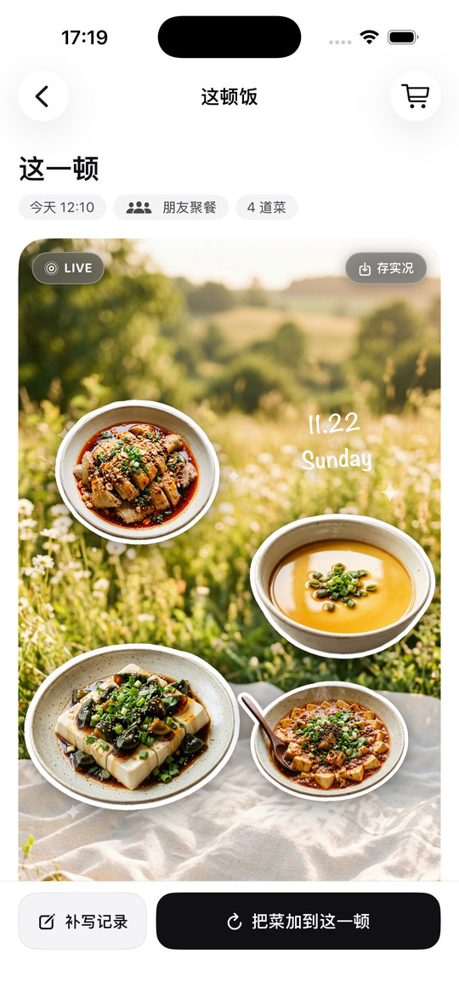<br />
      <b>实况画布回放</b><br />
      <sub>还原动效/滤镜、存实况、看大图与买菜清单</sub>
    </td>
  </tr>
</table>

### 4. DIY 开屏动画、小本本与程序外提醒

用同一套自由画布引擎亲手布置每次打开 App 的开屏问候，配合「我们的小本本」常吃统计与「动态通知 + 每日饭点铃」形成程序内外闭环。

<table align="center">
  <tr>
    <td align="center" width="25%">
      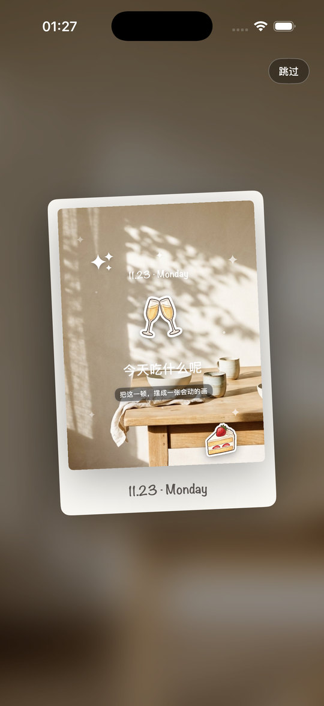<br />
      <b>DIY 开屏动画</b><br />
      <sub>4 种出场动效 + 3 档停留节奏</sub>
    </td>
    <td align="center" width="25%">
      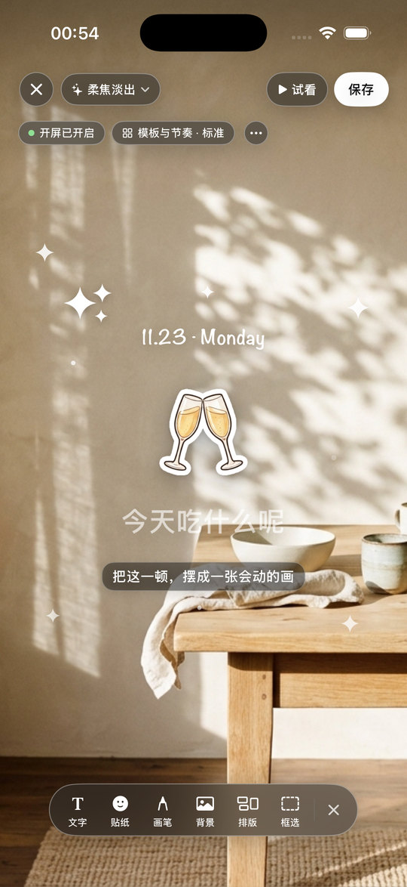<br />
      <b>开屏自由画布工坊</b><br />
      <sub>完整复用创作工具 + 4 套灵感模板与试看</sub>
    </td>
    <td align="center" width="25%">
      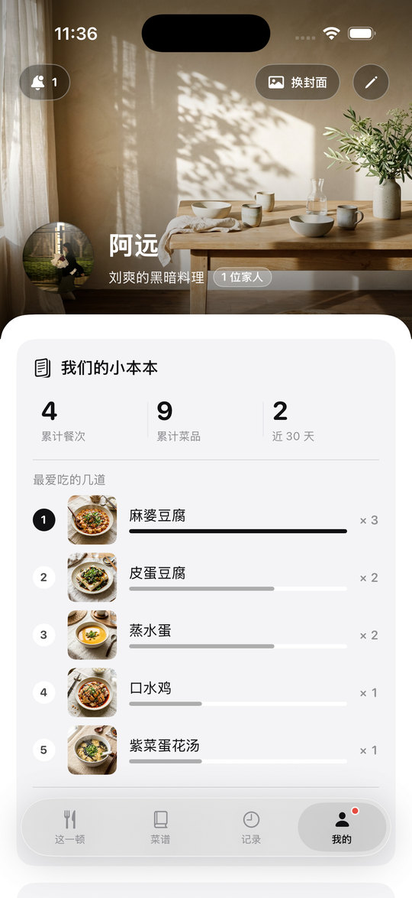<br />
      <b>个人页与小本本</b><br />
      <sub>330 pt 拉伸头图、常吃排行与入伙餐券</sub>
    </td>
    <td align="center" width="25%">
      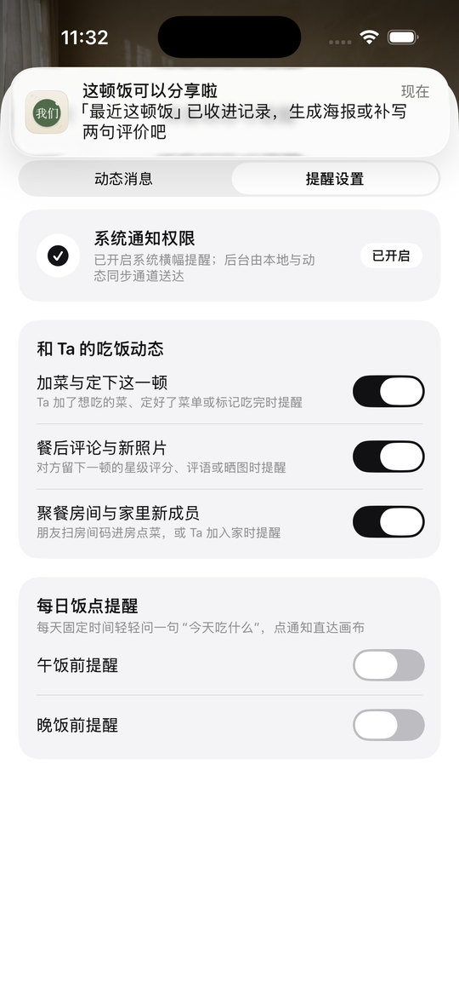<br />
      <b>双轨提醒 &amp; 外链直达</b><br />
      <sub>动态通知横幅、饭点定时提醒与 <code>lo://</code> 深链</sub>
    </td>
  </tr>
</table>

---

## 项目结构

```text
lover-order/
├── backend/                          # Go 1.24 + Gin + GORM + MySQL 8.0 服务与 APNs 推送
│   ├── cmd/server/                   # 服务入口与路由装配
│   └── internal/                     # config / model / service / handler / middleware
├── ios/
│   ├── project.yml                   # XcodeGen 工程描述（iOS 17.0+, 无第三方 Swift 包）
│   └── LoverOrder/                   # SwiftUI 客户端（App / Design / Features / Models / Network）
├── docs/
│   ├── assets/screenshots/           # README 与功能文档展示截图
│   ├── product-flow.md               # 产品方向与目标流程
│   ├── design/                       # 视觉与交互系统规范
│   ├── features/home-canvas/         # 当前画布与餐次真实可达行为说明
│   └── audits/                       # 产品与实现对齐清单
└── love/                             # 早期视觉参考图
```

---

## 本地快速启动

### 1. 启动后端（Go + MySQL 8.0）

请从 `backend/` 目录启动服务，确保 MySQL 已启动且 `backend/config.yaml` 中的数据库连接串正确：

```bash
cd backend
go mod tidy
mysql -u root -p -e "CREATE DATABASE IF NOT EXISTS lover_order CHARACTER SET utf8mb4 COLLATE utf8mb4_unicode_ci;"
go run ./cmd/server
```

- 默认监听 `:8081`，健康检查端点：`GET http://localhost:8081/health`。
- 如需真机启用 **Sign in with Apple** 或 **APNs 远端系统推送**，请在 `backend/config.yaml` 中分别配置 `apple.*` 与 `apns.*`（`.p8` 私钥路径、Key ID、Team ID 与 Bundle ID）。

### 2. 生成并运行 iOS 客户端（Xcode 16+ / iOS 17.0+）

项目由 XcodeGen 管理工程文件（`.xcodeproj` 不入库）：

```bash
cd ios
xcodegen generate
open LoverOrder.xcodeproj
```

- **接口地址**：iOS 模拟器默认请求 `http://localhost:8081/api/v1`；真机调试地址读取自 `ios/project.yml` 生成至 `Info.plist` 的 `API_BASE_URL`（不含 `/api/v1`，客户端自动拼接）。
- **认证与数据契约**：
  - 首次进入按设备唯一标识（iOS Keychain 持久化）只需填昵称即可自动建号进入（`POST /api/v1/auth/device`）；可在「我的 → 常用工具 → 账号与密码」设置 bcrypt 登录密码（`POST /api/v1/user/password`），换手机或重新找回时走「昵称 + 密码」登录（`POST /api/v1/auth/login`）；后端同时保留 `apple.*` Sign in with Apple 验证能力。
  - 后端使用 MySQL + GORM + 自签 JWT 与 WebSocket 房间服务持久化菜谱、分类、收藏、餐次、实时自由画布（`meal_canvases`）、评价、房间参与关系与通知流；接口与持久化场景值内部固定为 `household` 与 `dining`。
