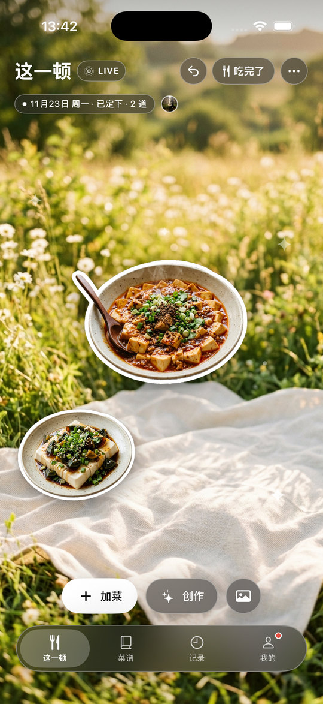
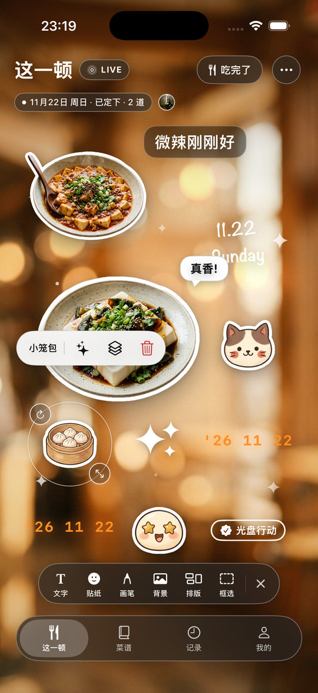
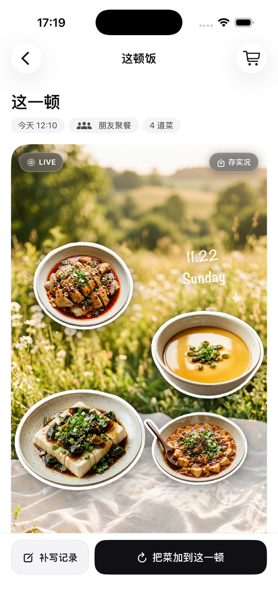

# 当前画布与餐次入口

本文描述当前代码中可达的行为。产品方向见[这一顿的自由画布](../../product-flow.md)；未对齐的实现另记在[代码对齐清单](../../audits/2026-10-canvas-alignment.md)。

<table align="center">
  <tr>
    <td align="center" width="33%">
       
      当前画布「这一顿」
    </td>
    <td align="center" width="33%">
       
      展开 6 项创作工具坞
    </td>
    <td align="center" width="33%">
       
      历史实况画布回放
    </td>
  </tr>
</table>

## 从首页编辑当前这一顿

登录并创建或加入家庭后，用户进入“这一顿”。首页主体是全屏无边框沉浸式实景 Live 拼贴画布，默认使用“暖阳野餐”实景氛围底图，也可切换“暖光咖啡”“斜阳画纸”“曜石暗台”“纯白画室”以及“海边”“黄昏”“夜色”等预设或照片背景；背景面板将“相册（从相册选）”入口固定排在第一位（其后依次为自选图与 `66×84` 竖版预览预设），并提供 5 档实时生效并随餐次文档持久化的“氛围滤镜”（**原图 / 暖阳 / 奶油 / 电影 / 清透**，导出实况照片与历史回放时一并保留）与“背景虚化”强度滑杆。顶部采用两行悬浮排布：第一行左侧显示“这一顿”与可点击的 `LIVE` 实况胶囊菜单（支持“保存为实况照片”、暂停/开启实况动效、“全部轻盈动起来”、“一键换排版”），右侧提供撤销调整（有可回退步数时显示）、自适应对比度的状态主胶囊按钮（“定下”/“吃完了”/“新一顿”）和更多菜单（内含“更换背景”“分享这一顿”等入口）；第二行左侧展示当日日期、餐次状态与菜数毛玻璃胶囊（“挑菜中”/“商量中 · N 道”/“已定下 · N 道”，点击可打开加菜面板）以及加菜参与者头像。新餐次默认附带一枚可自由拖动/编辑/删除的手写体日期文字便签，并配以轻盈闪光星点、光斑微粒与默认错相漂浮微动效。空画布中央展示“今天想吃点什么？”和“从菜谱加菜”入口；底部主操作区左侧的“+ 加菜”胶囊和右上更多菜单中的“从菜谱加菜”也可打开同一加菜面板。加菜面板顶部置顶横向展示当前桌上已选菜品（支持直接点击移除），输入框支持边输边搜菜谱或直接点 `+` 添加菜名，下方可从全部菜谱、收藏（爱吃的）、常做的（按使用次数优先）中点按整张菜谱卡加菜；加菜成功后，菜会出现在这顿菜单中，并按主次大小与微倾角自动避开画布已有内容生成对应贴纸。菜谱 Tab 与画布底部“已选 N 道”均围绕同一餐次实时同步。

画布底部悬浮区位于底部浮动液态玻璃主导航上方：默认收起为“+ 加菜”胶囊（实景/深色底使用纯白胶囊，浅纸底使用曜石黑胶囊）、“创作”自适应玻璃胶囊与右侧独立“更换背景”圆形快捷按钮；点击“创作”弹性展开为带短字标签的文字（衬线体 `T`）、贴纸、画笔、背景、排版与框选 6 项工具条，末尾附收起按钮；点“排版”可循环切换“错落拼贴 / 主菜居中 / 杂志对角 / 整齐画册” 4 套菜品与贴图一键构图（支持通过顶部撤销键一步恢复）；点“画笔”直接进入画布涂鸦模式。底部主导航以独立悬浮液态玻璃胶囊承载“这一顿”“菜谱”“记录”“我的”（进入菜谱详情、做法步骤、历史详情等沉浸二级页时自动平滑隐藏以防遮挡底部操作栏），在实景/深色画布首页下自动切为高对比透光深雾玻璃（顶部系统状态栏同步切为白色），在浅纸画布与其余 Tab 下保持冷银玻璃与黑色状态栏；图标均提供无障碍名称。菜品贴纸优先使用抠图透明图，不再常驻灰色菜名药丸标签，而由 `StickerBorderRenderer` 沿真实盘沿与勺柄边缘生成白边模切贴纸轮廓与立体桌影，也可在特效面板顶部一键切换为 **白边贴纸 / 纯净悬浮 / 拍立得**（拍立得保留相纸边与手写体菜名，仅点按选中时在悬浮操作条显示菜名）；当菜品仅有普通照片而缺少后端抠图时，真机客户端会通过 Apple Vision 前景主体分割与本地缓存（`DishCutoutCache`）自动实时抠图呈现；若普通照片也不可用，则回退为食品素材贴图或极简纯文字磨砂卡。新增文字、拍照/相册贴图、手绘贴纸和表情贴纸时，根据已有内容位置与大小估算空位，优先减少重叠；添加后仍可自由调整。

菜品、独立照片贴图、手绘贴纸、表情贴纸和文字可直接拖动。接近画布中心或其他内容的水平、垂直中心线时会轻吸附，出现对应位置的参考线和触感反馈；离开中心稍远一些才释放，减少临界位置反复吸附。点按选中后显示细圆框（拍立得贴纸与独立相纸贴图使用自适应圆角矩形框）、旋转（左上）及缩放（右下）手柄，文字按排版显示椭圆；再次点按已选中的纯文字便签可直接打开文字编辑面板。拖动旋转手柄可绕内容中心转动，拖动缩放手柄向外放大、向内缩小，范围为 30%–300%，内容中心保持固定。选框随内容等比缩放，手柄图标与圆环也适度缩放，触摸以 44 pt 圆形范围接收，两个手柄靠近时按距离分开重叠区域。按住手柄时另一个手柄淡下去；靠近画布边缘及底部操作区时手柄保持在可操作区域内。双指缩放和旋转也可使用。选中时内容特效暂停，方便看清和操作；移动、缩放或旋转期间收起悬浮菜单，底部工具变淡并暂停交互，松手后恢复工具并保存，取消选中后继续播放特效。长按内容的“精细调整”提供大小、角度滑杆，可恢复到 100% 和 0°。

选中后的悬浮操作胶囊左侧显示当前对象名称，右侧提供编辑文字（仅纯文字）、特效、图层（含非菜品元素的「复制一份」、层级移动与“选择内容”）和删除入口，点空白取消选中。图层菜单中的“选择内容”按前到后的顺序列出所有菜品、独立照片贴图、文字、手绘贴纸和表情贴纸，当前项带勾；可以直接选择被遮住、缩小或正在播放特效的内容，选框与操作条随当前对象切换。选择内容本身保留当前排版和前后层级。当前对象已在最前或最后时，悬浮操作条和长按菜单中对应的置顶、上移或置底、下移操作均显示不可用。菜品和独立贴图可在面板顶部切换 **白边贴纸 / 纯净悬浮 / 拍立得**，并在下方选择无、描边、柔光、呼吸、抖动、弹跳或漂浮（新增菜品默认启用漂浮微动效）；文字（“普通”无动效选项使用 `minus.circle` 图标）、手绘贴纸与表情可选择普通、打字、漂浮、扭曲、浮现或跳动。预览使用当前选中的内容，选择后立即应用并保存。新内容出现时轻微弹入，系统减少动态效果开启时保持静态。新建或编辑文字时提供 7 条快捷灵感短语、5 种文字样式（无底 / 磨砂 / 标签 / 纸贴 / 高光）、字体（圆体 / 衬线 / 等宽 / `Noteworthy-Bold` 手写体）、颜色、大小与实况动效直选（选中画布已有纯文字修改时实时生效）；提交后保留选中。点击底部“画笔”直接进入画布涂鸦模式，底部切为双排涂鸦工具坞（上排 6 色快选圆点 + 当前笔触状态，下排笔触设置、撤销、重做、清空涂鸦与完成，笔触面板包含实线/点点/虚线/荧光/蜡笔与 3 层光晕「霓虹」且所有连线按二次贝塞尔曲线平滑插值），画布顶部出现状态浮条提示。

底部“框选”图标进入框选模式，画布顶部显示提示浮条。单指拖出矩形，碰到范围的菜品、拍照贴图、文字和表情贴纸会实时选中；点按内容可补选或取消，点空白可清除选择。选中后拖动选区内任意位置即可整体移动，内容保持相对位置、大小、角度和层级；触及移动边界时整组停下，反向拖回立即跟随。框选时暂停内容特效，虚线与细框按背景明暗自适应（浅色纸纹用橄榄绿，深色照片用白色）；底部切换为全选、清空和完成。完成退出框选，保留排版。涂鸦不参与框选。

标题区右侧的联排毛玻璃回退/重做胶囊支持最多 20 步画布多步撤销与重做（`undoStack` / `redoStack`）。一次连续拖动、缩放、旋转或单笔涂鸦合为一步，多选整组移动、“精细调整”确认、文字增改、贴纸/表情增删、一键换排版及背景与滤镜切换均纳入撤销快照；撤销或重做会恢复画布排版、背景与涂鸦状态，同时保留后端实时同步的菜品增删而不覆盖当前菜单。

贴纸面板按“手绘贴纸 → 我的贴图 → 表情”排列，每次打开默认展示 16 枚原生矢量与编辑排版的美食手账 Plog 贴纸（如 `YUM!`、`今日份`、圆形厨房印章、`干杯`、`微辣刚好`、`Bon Appétit`、复古胶片日期、星光、弯箭头与和纸胶带，支持 4 色配色切换与「清空手绘」）。切换到“我的贴图”后，顶部并排提供“相册抠图”与“拍照做贴图”：相册选图会优先调用原生主体分割抠出透明 PNG（分割不可用或失败时自动回退为原图上传），上传后存入账号收藏并直接贴上画布；“拍照做贴图”打开自定义相机与主体浮起预览，保存透明 PNG 至收藏，收藏列表使用 `RemoteImageCache` 稳定加载缩略图，可点选连贴，长按可取消收藏；画布上的非菜品贴图可通过长按菜单“收藏贴图”或“复制一份”。表情标签内含 36 枚定制水粉手绘白边模切贴纸（按**精选 / 情绪 / 食光 / 氛围** 4 组陈列，资源命名 `StickerEmoji_*`，并支持实况照片直接烘焙渲染；历史文档中的旧版 Unicode 表情便签保留向后兼容渲染）。

收藏不依赖某一顿饭，可以在同一账号的其他设备重新载入。点选后添加的独立贴图沿用菜品贴纸的移动、缩放、旋转、特效和图层操作，增删菜品时仍会保留；贴图位置继续随本机画布文档保存。

新建或编辑菜谱时，“菜品主图”支持拍照和从相册选图。拍照复用同一自定义相机与主体分离预览，确认后分别保存普通照片和透明图；相册选图在普通照片上传成功后自动另存透明图。抠图失败时允许保留普通照片，之后可重新生成或继续保存菜谱。做法步骤可逐步配图，步骤拍照使用同一取景界面并保留普通照片。菜谱加入一顿时保存普通主图与透明图的快照，画布优先使用透明图并保留完整轮廓；没有透明图时显示实际照片，再按现有规则回退到食物素材或菜名。相册背景入口继续用于更换背景，读取失败时保留当前背景并提示重新选择。

连续手势期间保持当前操作对象，其他元素和画布空白暂不接收点击，松手后恢复。旋转与缩放一次响应一个手柄。拖动到画布边缘时重新记录该方向的拖动起点，反向拖回时立即跟随。浮动菜单按菜品、文字或表情的实际边框、大小和角度避让，空间不足时选择遮挡较少的位置。

缩放与旋转在操作中直接更新当前元素，以手势开始时的大小和角度计算。选框、手柄和内容读取同一组实时位置、大小与角度，触摸圆环边缘时按抓取偏移连续调整，仅按住不移动时保持原样。双指变换时暂停单指拖动；旋转接近水平或垂直时轻吸附，离开时平滑过渡到自由旋转。整组手势结束时统一保存，保留选中并给一次轻触反馈，松手只保存当前正在显示的结果，内容和手柄均不附加尺寸回弹，也不重新折算角度。

删除菜贴纸会移除这顿饭中的对应菜品。请求期间显示移除状态，成功后更新菜单和画布；失败时保留贴纸并提示原因。最后一道菜也可以删除；已定下的餐次删空后回到挑菜状态，继续保留同一张画布。拍照贴图、文字和表情的删除只作用于画布内容。

菜单和餐次状态在页面可见、应用活跃时约每四秒同步；完整画布的布局、文字、背景、涂鸦等仍按餐次保存在各自手机。另一位日常参与者目前能看到加减菜和餐次状态变化，不能据此看到完整画布编辑。

## 定下这一顿并记录吃完

准备中且至少有一道菜时，可点标题右侧的勾号定下这一顿，也可通过更多菜单“定下这一顿”或菜谱页确认菜单。定下后，标题右侧切为餐具图标，更多菜单显示“记录吃完”；点击会完成当前餐次并打开记录面板，关闭面板后首页载入下一顿。暂未提交评价时，可从首页右上更多菜单的“补写记录”继续填写，提交后清除该待补写入口。

定下后仍可编辑本机画布，也能通过底部“加菜”、更多菜单或菜谱页添加或移除菜品（最后一道菜也可移除并退回挑菜状态）。当前首页没有取消并重选的入口。

## 临时来客目前怎样参与

日常参与者从画布右上菜单“邀请一起点”进入开房页面。已有家庭的来客从“我的 → 去朋友那儿点菜”进入；没有家庭的已登录用户可在建家引导选择“不建家 只去朋友那儿蹭一顿”；正在参与他人点菜房间时，首页画布右上角会显示“在点菜”胶囊以便随时回到点菜页。

来客通过应用内扫码、输入房间号，或点击外部分享链接 `lo://room/<code>` 直接唤起 `DiningJoinView`（自动预填房间号）加入；进入后看到的是主家菜谱、已点菜列表和点菜按钮，可以加菜、移除自己点的菜，目前没有进入主家的同一张画布。当前房间有效期为六小时，关房或到期会停止继续点菜，已点菜保留，不会自动把餐次标记为吃完。开房页（`DiningHostView`）提供应用内二维码（`lo://room/`）、复制 6 位房间号与“发给朋友”系统分享（附带 `lo://room/<code>` 外链）；入伙餐券（`InviteTicketView`）“发给 Ta”同样附带 `lo://home/<code>` 直达链接。

## 消息提醒、饭点铃与外链直达

应用在登录就绪后通过 `LoverAppDelegate` 与 `NotificationManager` 向系统请求通知权限，并将已取得的 APNs 设备令牌上报至 `POST /api/v1/devices/register`（登出调用 `unregister`）；后端在加菜、定下这一顿、标记吃完、发表评价、朋友入房点菜及家人入伙时异步写入 `notification_events` 通知流，并在 `apns.enabled` 启用及 `.p8` 密钥配置完整时经 HTTP/2 发送 ES256 APNs 推送（未配置密钥时记录 dryrun 日志）。客户端另在活跃期定时拉取 `GET /api/v1/notifications`，结合通知开关为新到未读动态触发本地系统横幅；主界面“我的”底部导航栏角标与个人页左上角液态玻璃铃铛实时展示未读数量，常用工具首项提供 **消息动态与提醒**（`NotificationCenterSheet`），支持查看/全部已读、点击消息跳转至对应画布/历史详情/个人页、发送“演示提醒”，以及配置每日 **午饭前 / 晚饭前提醒**（`UNCalendarNotificationTrigger` 本地定时提醒）。应用已注册 `lo://` URL Scheme（`lo://home/`、`lo://room/`、`lo://meal/`、`lo://history/`、`lo://household`），收到通知点击或外部唤起时由 `RootView` 与 `AppState` 路由至对应页面（未完成登录引导前自动挂起并在登录后衔接）。

## 历史、菜谱、加菜与个人页的当前承载

记录页顶部展示累计顿数与筛选状态；列表以日期、菜品和回忆内容展示已完成餐次，场景筛选收在右上高亮圆按钮中，“记一顿”（`ManualHistoryEntryView` 采用 `SectionCard` 与分段场景选择器，`household` / `dining` 值保持不变）可以另建餐次补录。首条包含本机画布或评价照片的餐次展示 `264 pt` 高全幅海报卡（`HistoryHeroCard`，画布通过 `fillsContainer` 全幅铺满且整卡均可点击进入）；存在本机画布文档时，记录卡片会还原画布并在左上展示单行 `LIVE` 徽标；无画布与照片且尚无菜品时，暖纸占位展示极简日历月日印记；进入历史详情（及菜谱详情、做法步骤）后会自动隐藏全局悬浮底栏，详情页以保存尺寸动态回放背景、氛围滤镜、微动菜品贴纸、手绘贴纸（含 36 枚自定义表情贴纸）、文字特效、星点闪光与笔迹（支持点击左上高对比透光深雾玻璃 `LIVE` 按钮暂停/恢复动效，点击右上 `存实况` 导出实况照片，或点击右上购物车按钮打开适配新版中性视觉的 `ShoppingListView` 一键复制买菜清单），不显示编辑控件，按「吃了这些（关联菜谱可直达菜谱详情）→ 备注和照片（点按任意照片打开全屏 `HistoryPhotoGalleryViewer` 左右翻页与 1×–4× 双指/双击缩放看大图）→ 一起吃饭的人（单人采用紧凑 `58 pt` 排版，统一使用 `AvatarView`）」排序，并在顶部栏、底部栏及首页“这一顿”更多菜单均接入 **分享这顿饭（`MealSharePosterSheet`）**——预加载自由画布静图、评价实拍图与各菜品图及前景抠图白边贴纸，支持在 **电影画报 / 餐桌拼贴 / 胶片画册 / 私房菜单** 4 套高画质模板间切换、一键轮换主图与控显“菜品 / 评价与留言 / 同行的人”，一键渲染 `@3x` 海报调起系统分享或存相册（有本机画布时另支持直接导出实况），底部同时保留“把菜加到这一顿”+“去画布”快速复用整顿菜单。

菜谱页顶部展示 `共 N 道菜` 副标题，围绕“当前这一顿”实时同步选菜状态：分类采用曜石黑激活胶囊，菜品卡片右上 `+` / `✓` 支持当前餐次双向加入与移出，底部紧凑悬浮条（`已选 N 道` + `定下这顿` / `去画布看看`）浮于液态玻璃主导航上方；`AddDishView` 加菜弹窗同步升级为胶囊搜索框、曜石黑切换栏（`全部 / 爱吃的 / 常做的`）、支持点选双向增减的 `RecipeCircleCard`（`已是桌` 徽标 + `✓`）与动态人数提示 `挑好了 · N 道`。菜谱详情页（`RecipeDetailView`）顶部采用 `340 pt` 全幅画廊（配浅白顶部薄雾渐变保对比）与向上承托的圆角白底内容页，食材栏使用极简 6 pt 圆点且末行去分隔线，做法入口采用曜石黑序号图标卡，加入后底栏切换为“已加入 · 去画布”；做法步骤页（`RecipeStepsView`）同样自动隐藏底栏，使用 `FlowLayout` 食材胶囊、曜石黑序号卡片与底栏分隔线。

个人页（`ProfileView`）采用 `330 pt` 高全幅沉浸式拉伸头图（无自定义封面时默认使用清晰自然采光的 `ProfileHeroCover` 餐桌实景摄影，无模糊处理，顶部配浅压暗渐变，底部平滑衔接圆角白底内容页；头图左上角悬浮液态玻璃消息铃铛与未读计数，右上方悬浮深雾玻璃“换封面”胶囊与圆形编辑按钮——已设置自定义封面时点“换封面”弹出「从相册换一张」与「恢复默认封面」双选项）。头图停留屏幕上方时系统状态栏同步切为白色，向下滚动露出“我们的小本本”后自动加覆顶部安全区毛玻璃保护条并将状态栏切回黑色。“我们的小本本”以加粗圆体数字搭配第一名曜石黑徽章、菜品点选占比进度条及带场景图标的“吃饭的场合”胶囊呈现；“常用工具”首行接入 **消息动态与提醒**，其下接入 **定制开屏动画**（全屏自由画布开屏工坊 `LaunchCanvasStudioView`），次行及以下保留分类管理与来客点菜入口；“我们的家”展示成员叠放小头像与嵌入式邀请码卡片（右侧内置复制与刷新圆按钮），并保留“叫 Ta 进来”（曜石黑入伙餐券票头 `InviteTicketView`）和确认退出的完整流程。

冷启动进入 App 时展示全屏自由创作的 **开屏动画**（`RootView` 中的 `LaunchCurtainView` 调用 `LaunchCanvasPlaybackView` 动态回放本机 `LaunchCanvasStore` 保存的 `CanvasDocument`），默认展示「晨光餐桌」实景与动效贴纸文案，随启动引导就绪自动退场并支持右上“跳过”或轻触跳过；从“我的 → 定制开屏动画”可全屏进入 **自由画布开屏工坊（`LaunchCanvasStudioView`）**，完整复用「这一顿」自由画布全部创作工具——文字样式与手写字体/动效、36 枚水粉贴纸表情、16 枚手绘 Plog 贴纸、相册/拍照主体抠图贴图、画笔与霓虹涂鸦、相册/内置实景背景（含“晨光餐桌”）+ 5 档氛围滤镜 + 背景虚化、排版（`stickers` 为空时直达模板）与模板套用、框选整组移动及 20 步多步撤销重做——顶部 `LaunchStudioOptionsSheet` 额外提供开关、4 种出场动效（`柔焦淡出 / 拉开帘幕 / 拍立得飞入 / 轻盈落星`）、3 档停留节奏（`轻快 1.1s / 标准 1.5s / 慢赏 2.2s`）、4 套开屏灵感模板（`晨光餐桌 / 暖阳野餐 / 夜色胶片 / 留白画纸`）、恢复默认以及全屏即时“试看”。

餐后记录面板（`MealReviewView`）优先展示备注和最多九张照片，再展示与历史/菜谱页一致的星形口味评分；底部并排提供 **“保存并分享”**（提交后刷新餐次并直接弹出 `MealSharePosterSheet` 生成分享海报）与“保存记录”；从历史详情再次进入记录面板时会回填当前用户已有的备注、照片和评分，避免修改时丢失原有内容。文字和照片仍保存在个人评价中，后端要求评分，面板默认五分；这还不是整顿饭独立的备注与图片模型。照片上传期间不能保存或关闭记录面板；失败时保留已填写内容，重新选择可以继续。

“保存为实况照片”（位于首页左上 `LIVE` 菜单与右上更多菜单，以及历史详情 `存实况`）会使用 `ImageRenderer` 逐帧渲染 3 秒（72 帧 @ 24 fps）无控件纯画面，通过 `AVAssetWriter` + QuickTime 配对元数据（`content.identifier` / `still-image-time`）生成 `.mov` 与带苹果配对键的 `.jpg` 封面，并通过 `PHAssetCreationRequest` 一并写入系统相册成为真 **Live Photo**；同时保留“保存静态图片”导出当前画布静态图。画布文档仍存于当前手机。
